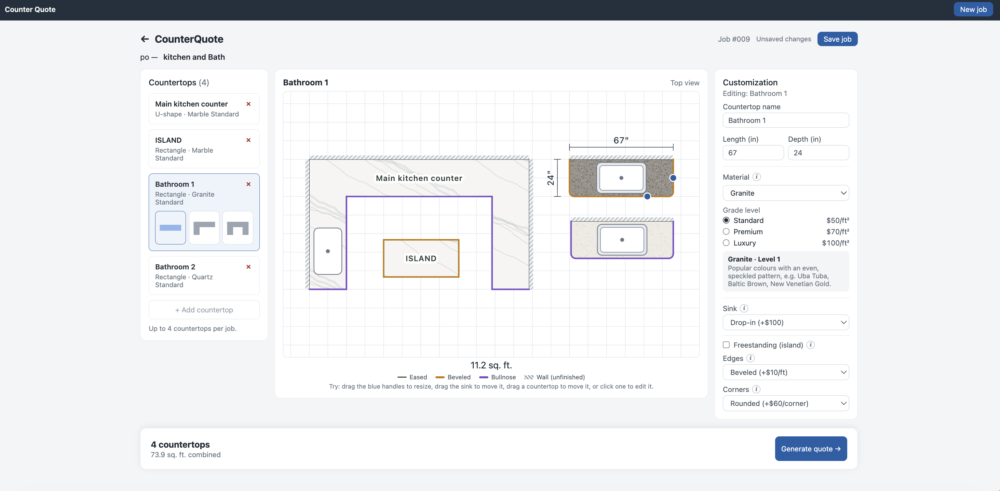
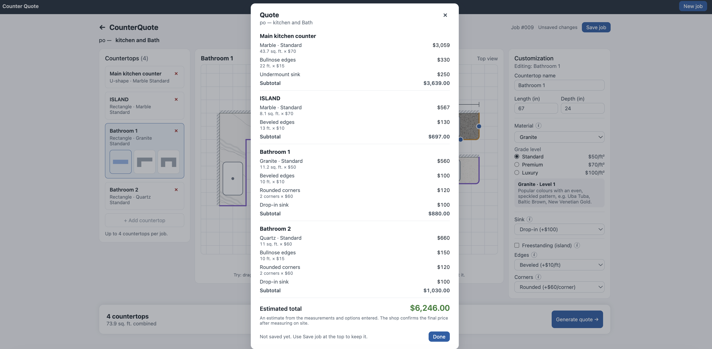
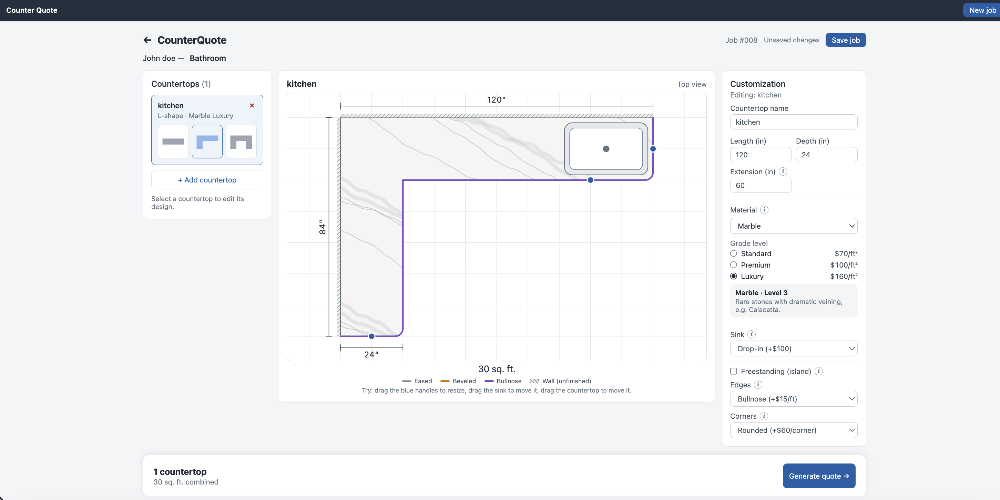
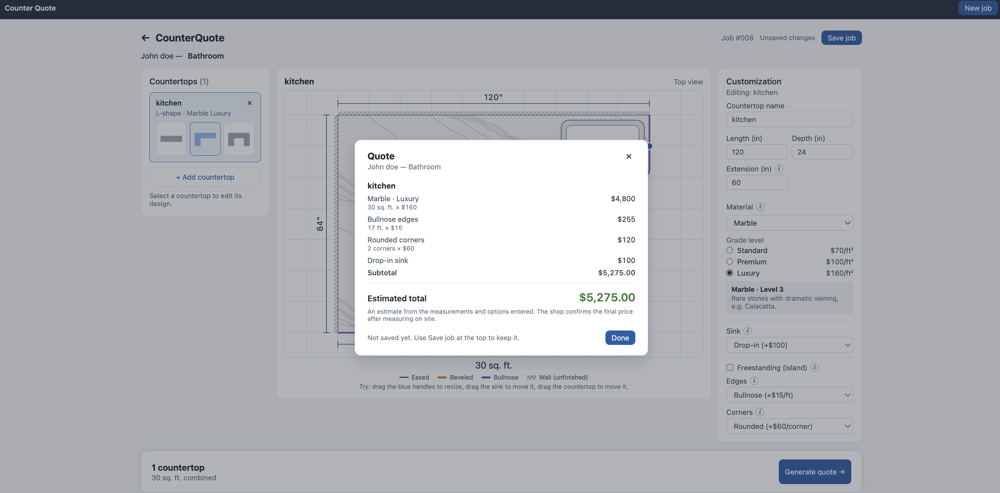

# Answers

- **Name:** Ruthu Rajendra
- **Email** (the one you applied with): ruthurajendra@gmail.com
- **Phone** (optional):4086408650
A few sentences each is plenty.

## 1. What did you need to research, and how did you do it?
I started by going through the README and understanding the requirements. Since I only had basic knowledge about countertops, I wanted to dive deeper and understand the different types of countertops, materials, shapes, edge profiles, corners and sinks.

I also wanted to understand the process from a customer's point of view, so I explored a few existing countertop design applications and started designing my own countertop. This helped me understand what customization options were available, how they worked and what a customer would expect from such an application.

I then looked at it from a seller's perspective to understand what information would be needed to generate a quote and how the process could be made easier for both the customer and the seller.

Based on this research, I identified the most important features to include. I didn't want to overcomplicate the application, so I decided to focus on the most commonly available materials and customization options.

Once I had a better understanding of the domain, I researched pricing, made a list of functional requirements and started planning the design and implementation.

References:
- https://206granite.com/express-pricing/ — Helped me understand the overall countertop cost breakdown.
- https://www.stonify.io/resources/industry-knowledge/pricing-add-ons/ — Helped me understand additional costs for edges, corners and sinks.
- https://www.homedepot.com/services/c/cost-install-countertops/6228e49a9 — Used to understand average countertop prices.
- https://www.stonify.io/resources/industry-knowledge/cost-by-material — Helped me understand pricing differences between materials.
- https://slabwise.com/guides/granite-countertop-cost-per-sf — Helped me understand different price ranges for granite.


## 2. How did you decide what to charge for, and how?

Based on my research, I compared pricing across different websites and existing countertop applications. I decided to keep my prices close to the ranges I found to make the estimates as realistic and reliable as possible.

I broke down the pricing into four categories:

- Material: Charged per square foot of the countertop.
- Edges: Charged per linear foot of finished edges.
- Corners: Charged per corner based on the selected treatment.
- Sinks: Charged a fixed amount based on the type of cutout.

While researching material prices, I noticed that the same material could have a wide price range depending on its appearance, availability and patterns. Instead of using a single average price, I introduced three pricing levels (Standard, Premium and Luxury) to give customers more flexibility based on their budget.

I also came across a few websites where basic edge and corner treatments were included in the base price, and only premium treatments had additional charges. I decided to follow a similar approach in my application.

## 3. How did you use AI? Where did it help, and how did you lead it?
Once I was done with my research and had a clear understanding of the functional requirements, I listed everything I wanted to implement and provided it to AI to help create a development plan.

I went through the plan to understand the potential challenges, different implementation approaches and their trade-offs. AI helped me explore different solutions and understand which approach would be simpler and more suitable for the scope of the project.

Rather than asking AI to build the entire application at once, I broke down the implementation into smaller steps. I provided specific instructions for each feature, reviewed the output, and refined my prompts whenever changes were needed.

I also made decisions about which features to include, simplify or leave out to avoid overengineering the application. AI helped with planning, implementation, debugging and exploring UI designs, while I guided the overall direction and made the final decisions.
## 4. What would you ask an industry expert to check or improve this?
Since my understanding of the industry is based on research, I would like to understand the real-world experiences of someone who works directly with customers.

Some questions I would ask are:

What are the most common difficulties you face when working with customers?

Are there any recurring issues? Why do they occur, and what makes them difficult to resolve?

Are there any unexpected customer requests or issues that occur more frequently than you would expect?

What aspects of countertop design or pricing are difficult to explain to customers?

What are the limitations of the applications or tools you currently use?

Are there any additional features that would help you better communicate with customers or make the quoting process easier?

My main goal would be to understand their current workflow, requirements and pain points. This would help me identify meaningful improvements based on actual industry needs rather than adding features based on my own assumptions.

## 5. What did you leave out, and what would you work on next?
For this version, I focused on keeping the application simple by including the most popular materials and commonly used customization options. I intentionally left out more complex shapes and advanced customizations to focus on getting the core functionality right.

Some of the things I would work on next are:

Expand each customization category with more materials, specifications, edge profiles, corner treatments and sink options.

Support more complex and irregular countertop shapes.

Improve the visual experience with more realistic material textures, backgrounds and a real-time preview of how the countertop would look in a kitchen.

Provide more detailed information about each customization to help customers make informed decisions.

Introduce an AI chatbot that customers can use to ask questions about materials, customizations, maintenance and how their choices affect the overall cost. Especially since I am sure a lot of users like me have no idea about the trade offs!

I would also prioritize future improvements based on feedback from industry experts and customers to make sure the additional features solve actual problems.
## How to run it

Nothing extra to install beyond what the README asks for: Docker, or .NET SDK 8+ and Node 20.19+ / 22.12+.

**With Docker**, from the project folder:

```
docker compose up --build
```

**Without Docker**, in two terminals from the project folder:

```
cd backend/CounterQuote.Api
dotnet run
```

```
cd frontend
npm install
npm run dev
```

Then open http://localhost:5173.

The database is created on first run. The API applies all migrations on startup, including the price list (18 prices: 3 materials × 3 grades, plus edges, corners and sinks). To start from an empty database, stop the app and delete every file in `data` that starts with `app.db`.

**Tests:**

```
cd backend && dotnet test        # 5 API tests
cd frontend && npm test          # 55 tests on geometry, pricing, saving and job state
cd frontend && npm run build     # type check and build
```

## What we should know to evaluate it

What to try first:

1. Create a new job and open it. It starts with an empty canvas.
2. Add a countertop and pick the L shape.
3. Drag the blue handles to resize it and watch the price change. Drag the sink to move it.
4. Add a second countertop, make it a rectangle and tick Freestanding (island). Drag it next to the L.
5. Change the material, grade, edges and corners. The ⓘ icons explain each option.
6. Click Generate quote to see the price breakdown, then Save job. Reopen the job to check it was saved.

Features you might miss:

- A job can have up to 4 countertops, each customised separately.
- Each quote line shows how it was worked out, e.g. "30 sq. ft. × $80".
- Each material has three grades: Standard, Premium and Luxury.
- Freestanding (island) charges for every edge. Edges against a wall are not charged.
- Two countertops that overlap are outlined in red with a warning.
- Countertops, handles and the sink can also be moved with the arrow keys.
- Jobs can be deleted from the jobs list.

## Screenshots

The images are in the `screenshots` folder.

1. A job with four countertops: a U-shaped kitchen counter with an island inside it, and two bathroom vanities.



2. The quote for that job, with each countertop's charges, subtotals and the total.



3. A single L-shaped countertop in Luxury marble, with Bullnose edges, rounded corners and a drop-in sink.



4. The quote for that countertop.



